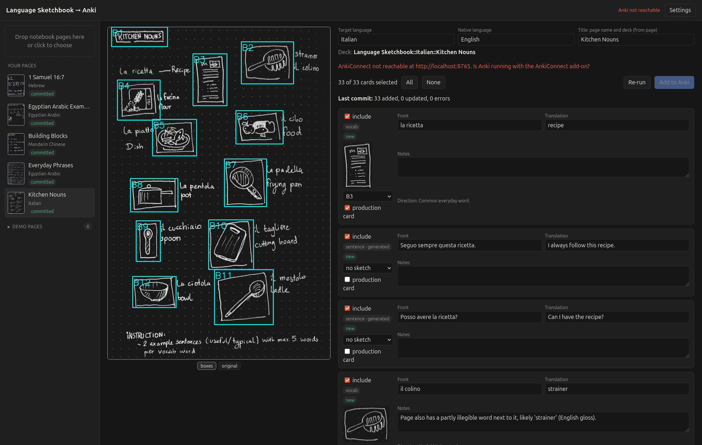

# Language Sketchbook → Anki

Photograph a page of your handwritten language notebook and get Anki flashcards from it, sketches included.



1. **Box detection** (OpenCV) finds the hand-drawn boxes around your sketches and crops them.
2. **Claude** reads the page, with **PaddleOCR** as a second opinion for diacritics, tones and non-Latin scripts. It matches sketches to words, works out language and topic, and follows instructions written on the page (e.g. "2 example sentences per word").
3. **You review** the proposed cards in a local web UI: edit, deselect cards, apply suggested fixes from flagged doubts, and choose how to drill sentences: translate them, blank just the word they illustrate, or build them up chunk by chunk. Added notes to a page later? *Update photo* on it: your review decisions are kept and only what changed needs a look.
4. **Commit** to Anki via AnkiConnect, into a deck per language and topic. Notes already in Anki are updated in place, so their review history stays. Or, under *Settings*, to [DSL](docs/architecture.md#dsl), a plain-text notes app: one note per page, with the page photo and sketches attached.

## Requirements

- Linux with an NVIDIA GPU (PaddleOCR is installed with CUDA 12.9; for CPU see [docs](docs/architecture.md#ocr-on-cpu))
- [uv](https://docs.astral.sh/uv/) and [just](https://github.com/casey/just)
- [Claude Code](https://claude.com/claude-code), logged in (the agent runs via the Claude Agent SDK)
- [Anki](https://apps.ankiweb.net/) with the [AnkiConnect](https://ankiweb.net/shared/info/2055492159) add-on, running; or a DSL data folder

## Usage

```sh
just reinstall   # install dependencies and a desktop entry (Fedora/Ubuntu)
just run         # start, or open the browser if already running
just dev         # server with auto-reload
```

The UI runs at <http://localhost:8642>. Upload pages, wait for the proposal, review, commit. The `NB Vocab`, `NB Sentence` and `NB Cloze` note types are created in Anki on the first commit (or under *Settings*).

Four demo pages from `examples/` are in the sidebar, already processed, so you can try the review step right away. They collapse once you add pages of your own.

Uploaded pages and settings are stored in `data/`; you can choose another folder under *Settings*.

More: [how it works](docs/architecture.md).
